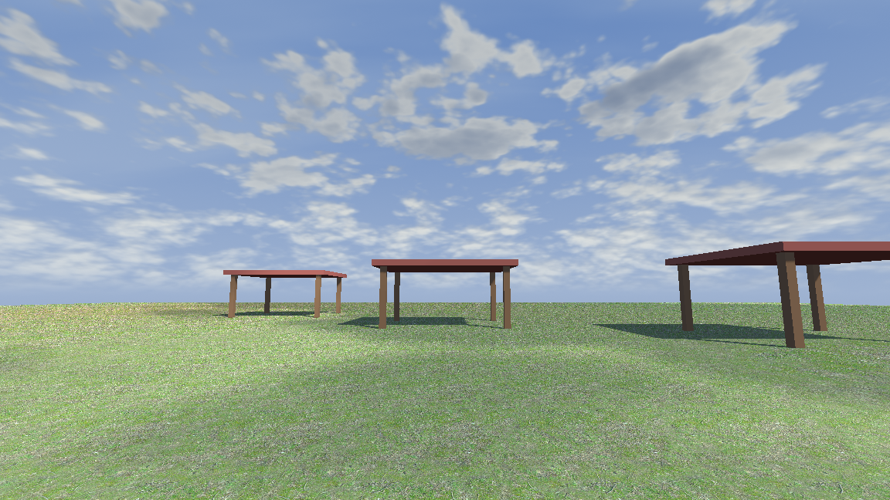
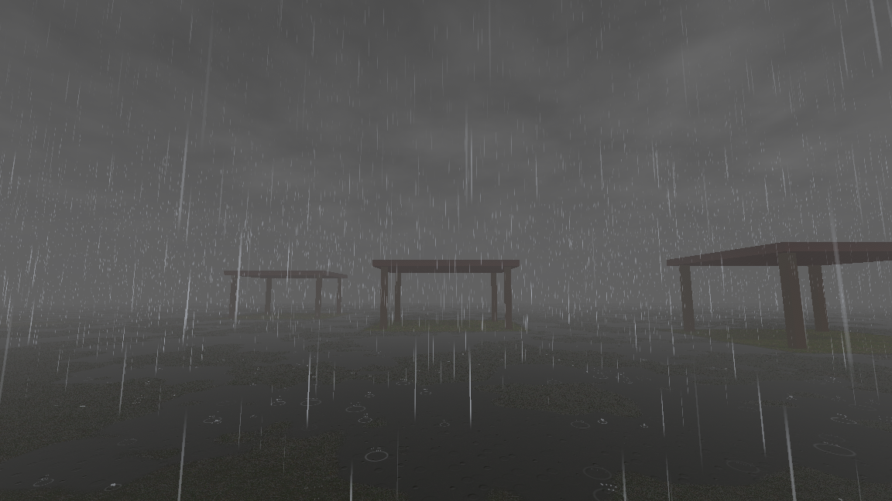
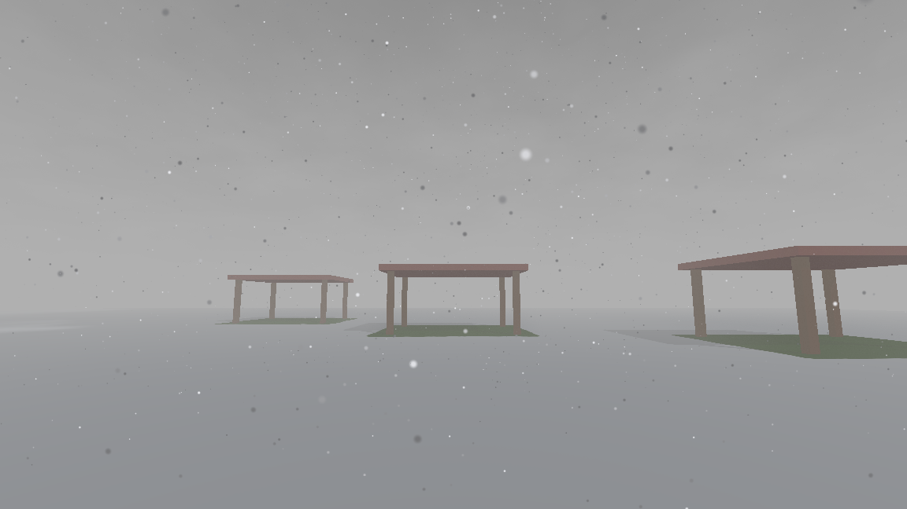

# Overcast

[](https://github.com/alanfischer/overcast-godot/actions/workflows/tests.yml)

Sky, clouds and weather for Godot 4. The weather shows up in the world under the sky too: cloud
shadows drift across the ground, rain and snow stay out from under roofs, the ground gets wet or
snowed over, rain sounds muffled indoors, and lightning lights the open ground but not a torch-lit room. It works on every
renderer, including Compatibility and Mobile.





## Quick start

Copy `addons/overcast/` into your project and enable the plugin. The plugin declares Overcast's
global shader uniforms, which every Overcast shader needs to compile.

1. In your WorldEnvironment's Environment, set Background to Sky, and pick **New OvercastSky**
   as the Sky's material. Set its `sun_dir` to match your sun.
2. Add an **OvercastWeather** node. Drag its box (`area`) to cover your level and press
   **Bake Rain Floor**. Then drag `rain` up, and `snow` up to turn it to snow. The rain, the snow,
   the storm closing over, wet and snowy ground and the lightning (**Strike**) all show in the
   editor. The node warns you if it has no sky or rain floor.
3. For wet and snowy ground and cloud shadows, call `OvercastMaterials.watch($Level)` once the level is
   loaded: it converts its StandardMaterial3Ds, and those of what spawns into it. Your own shaders
   take the includes instead (below).

The same from code:

```gdscript
var sky := OvercastSky.new({"cloud_amount": 0.4, "sun_dir": OvercastSky.sun_dir_of($Sun)})
$WorldEnvironment.environment = sky.make_environment()

$OvercastWeather.rain = 0.6  # 0 dry … 1 a downpour; it finds the scene's sky by itself
$OvercastWeather.snow = 1.0  # how much of it falls as snow: 0 rain, 1 snow, sleet between
```

Run `demo/demo.tscn` to see all of it. It has a field and a few open huts, with sliders for
rain, snow and the time of day, a lightning button, a volumetric-clouds switch, and a mode where showers come
and go on their own.

## What's in it

- **`OvercastSky`** is a sky material, with a `time_of_day` in hours: its day colours warm into a
  sunset at 18:00, go to moonlight and stars at night, and come back through dawn at 6:00. The
  sun crosses the sky with it (`sun_dir` is where it is at noon), and the weather's `sun` light
  turns to match. For a sun baked into your lighting, turn off `sun_follows_time`: the sun and
  moon then stay at `sun_dir`.
  `scene_light()` is the light it puts on your scene at that hour, for a sun's colour or a
  lightmap; `light_dir()` and `light_strength()` are where the sun or moon is and how strongly it
  shines, as the moon comes up from nothing once it takes over at dusk. It draws a gradient, a
  sun, stars, cirrus and a cumulus layer that closes over into a storm deck as `storm` rises. Its look is its shader parameters;
  the cloud layer's scale, speed and shadows are its own properties. Save it as a `.tres` to
  share one sky between scenes. The sky shader is `shaders/sky.gdshader`, built on
  `sky.gdshaderinc`. To draw the sky on your own geometry instead of a Godot `Sky`, include that
  file in a spatial shader and pass it as `OvercastSky.new({}, shader)`.
- **Volumetric clouds**: `OvercastClouds.set_volumetric(true)` ray-marches the clouds through 3D
  noise. That costs about a millisecond at 720p on an M1 on Compatibility. The radiance cubemap
  pass skips the clouds, so ambient light stays cheap.
- **`OvercastMaterials`** gives StandardMaterial3Ds cloud shadows, wet ground and snow.
  `apply(root, puddle_scale)` swaps each one under `root` for a ShaderMaterial
  (`shaders/standard.gdshaderinc`) that draws it the same way and adds the clouds, rain and snow. The
  meshes keep their own materials: the swaps go on as surface overrides. Godot gives scripts no
  way to add code to a StandardMaterial3D's shader, so the converted shader redoes Godot's
  lighting: on Compatibility it matches pixel for pixel, on Forward+ and Mobile to within a few
  levels on rough metals. It covers albedo, metallic, roughness, specular, normal, emission and
  occlusion maps, ORM textures, vertex colour, transparency, cull and blend modes. A material
  using anything else (rim, clearcoat, triplanar, billboards, unshaded…) is left as it is.
  `watch(root)` does the same, then converts what is added under `root` later, at the end of
  the frame it was added in, after its `_ready`. Code that edits a material after that edits
  `OvercastMaterials.source_of(mat)`, or a copy of it, and converts that again with
  `convert_material`.
- **Cloud shadows.** Include `shaders/clouds.gdshaderinc` and multiply your sun light by
  `cloud_sunlight(world_pos)`. The shadow comes from the same cloud the sky draws in front of
  the sun, so what's on the ground matches what's overhead. `demo/ground.gdshader` shows how in
  `light()`. For a game with baked lighting, scale the sun's share of each lightmap texel
  instead.
- **`OvercastWeather`** handles the rain and snow:
  - drops or flakes in a box around the camera; `snow` says how much of `rain` falls as snow.
    Most drops are fine and a few big; they show against the ground and hardly at all against
    the sky, as real rain does
  - `wind`, with gusts (`gustiness`): the rain slants and sways, the snow is carried off on it, and
    whatever stands upwind keeps rain and snow off the ground in its lee
  - splashes where the rain lands, on roofs and the open ground, with rings where it lands in
    standing water. They land on the rain floor, so they need one
  - haze and far rain only through air that rain is actually falling in; snow turns the storm
    sky a pale grey, and hazes less
  - wet ground and puddles on every material that includes `shaders/wet.gdshaderinc` and calls
    `overcast_wet_pbr(albedo, roughness, specular, world_pos, world_normal)` from `fragment()`:
    darker, smoother, puddles that reflect the sky. Nothing to register; each material's
    `puddle_scale` says how readily it pools. While it rains, ripples spread over the puddles;
    `overcast_wet_normal()` bends `NORMAL` by them too, for reflections that can show it.
    `overcast_wet()` is the same for a shader that lights itself, such as a lightmapped one.
  - lying snow on every material that includes `shaders/snow.gdshaderinc` and calls
    `overcast_snow_pbr(albedo, roughness, specular, world_pos, world_normal)` after wetting it:
    a dusting in patches first on what faces up, then a layer over all of it, never under a
    roof. It settles while more snow falls than rain and melts, wetting the ground, once it
    stops; rain melts it faster. `overcast_snow_normal()` rounds the lighting over it, and
    `overcast_snow_glint()` in `light()` makes it glitter where the sun reaches it
    (`demo/ground.gdshader` shows both). `snow_scale` says how readily a material holds it, and
    `overcast_snow()` is the version for a shader that lights itself. The weather's
    `snow_lying` says how much lies, for a game to stop its exposure down by. Snow does not
    thunder.
  - rain sound that fades and low-passes under cover
  - lightning: a glowing bolt, a flash, and thunder delayed by the distance
  - its own rain loop and thunder, CC0 (`sounds/CREDITS.md`). Set `rain_stream` and
    `thunder_stream` to use your own, and `bolt_drawer` to draw bolts your way.
- **`OvercastRainFloor`** is where rain stops: roofs, overhangs, the ground. The weather's
  **Bake Rain Floor** raycasts down through your level's colliders once and saves it beside the
  scene as `<scene>_rain_floor.res`. A level built at runtime calls `bake_rain_floor()` after a
  physics frame instead. Without a rain floor, rain falls everywhere. Off its edges none falls,
  unless `rain_beyond_floor` is on: for an open world, such as an island in the sea. In wind,
  the shaders read it along the rain's slant, taking what it holds as solid to the ground: a lee
  stays dry, and rain never blows in under a roof. `floor_at()` and the rain sound go straight
  down.
- **Covers** are things that move and keep the rain off: lifts, trains, drawbridges, a wall that
  can be knocked down. `add_cover(node)` rasterizes the node's own meshes onto the rain floor
  wherever it goes, so each cell takes the highest of it over that cell: something rotated,
  L-shaped or pitched keeps rain off exactly what is under it. A box or triangles of your own
  work too. A cover that only slides reuses its raster, and turning ones share out a per-tick
  budget. A hidden cover keeps nothing off. Drops, haze, wet ground and rain sound all follow it.
- **Showers:** turn on the weather's `cycle` and rain comes and goes on its own, building,
  wandering and dying away (`OvercastCycle`). The same `cycle_seed` gives the same weather.
- **Tuning** that a game would want to change is in the inspector: haze, drop and flake counts,
  how fast ground soaks and dries and snow settles and melts, the gaps between strikes, how dark cloud shadows are, how high the
  clouds sit.

## Networked games

Overcast has no networking of its own; you sync two things.

1. **Rain:** sync `rain`, `snow` and `wind`, or share `cycle_seed` and `cycle_time` (and `snow`
   and `wind`). Gusts are each peer's own: they only sway what is drawn.
2. **Lightning:** let one peer time the strikes (`times_strikes = true`) and send the seed from
   `struck` to the others, which call `strike(seed)`. The bolt, flash direction and thunder all
   derive from the seed, so every peer sees the same strike.

A headless server draws nothing, but `floor_at(point)` still answers where rain stops there,
moving covers included, for gameplay that cares whether something is out in the rain.

## Lighting the scene

Overcast lights its own sky, rain and haze. For your scene, it gives you hooks:

- `flash_changed(k)` fires every frame of a strike. Add `OvercastWeather.FLASH * k` to the sky's
  light on your scene.
- The rain and haze are lit by the sky's `scene_light()`. If your scene is lit some other way,
  turn off `light_from_sky` and set `sky_light`. The sky's time of day sets how bright lightning
  lights it.
- `sun`, if set, is a `DirectionalLight3D` that dims under the storm and lights up with each
  flash.

## Limits

- One sky draws the cloud layer, and one weather drives the rain, at a time, because both reach
  your shaders through global shader uniforms. The sky that last started drawing owns the clouds;
  when it stops, the one before takes them back.
- The sky's sun is its `sun_dir`; it does not follow a DirectionalLight3D by itself.
- The sun's path is an equinox's: up at 6:00, at `sun_dir` at noon, down at 18:00, with the moon
  on the same arc at night. There are no seasons or latitude.

## Origin

Overcast comes from [Wizard Wars](https://github.com/alanfischer/wizardwars), a GoldSrc mod
ported to Godot. Its maps are lit by baked lightmaps, which is why cloud shadows and lightning
work through a light multiplier rather than through Godot's dynamic lights. The game plays on
Quest as well as desktop, which is why everything works on Compatibility.

The cloud layer sits 100 m up by default, tuned to maps a few dozen metres across. For a bigger
world, raise the sky's `cloud_height`: the clouds and lightning scale with it.

## Tests

`./run_tests.sh` runs the suites headless. CI runs them on Godot 4.4 and 4.7.

## License

MIT
